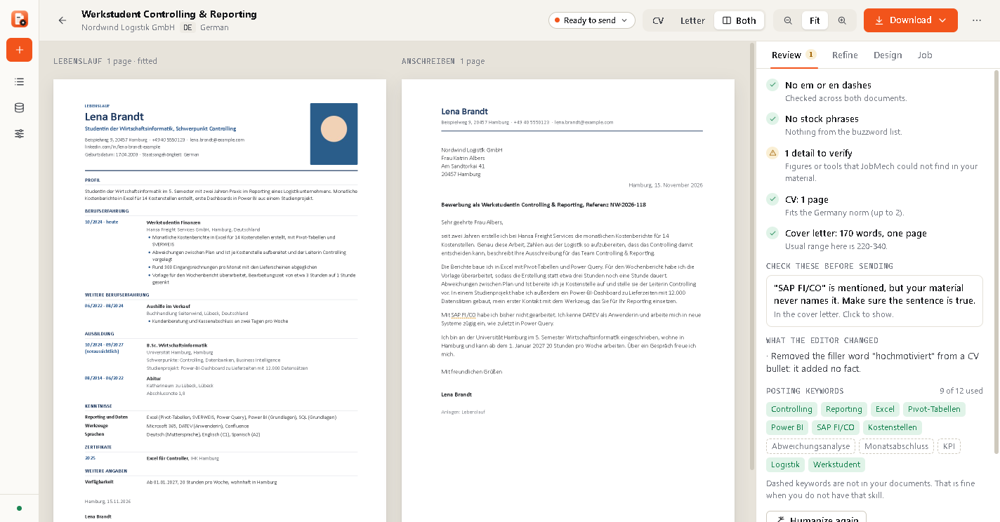
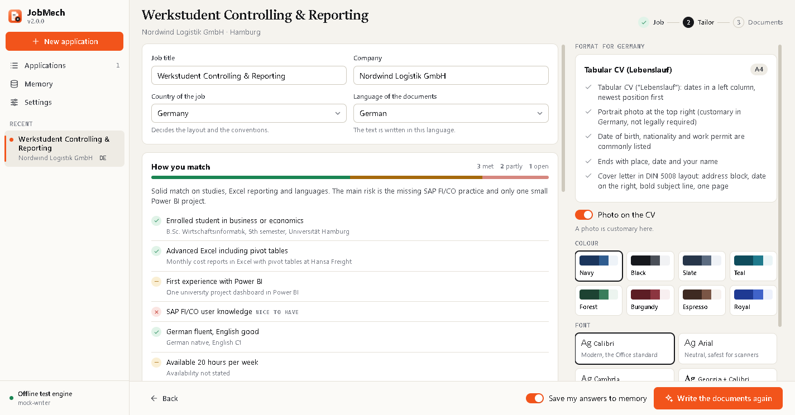

# JobMech

**Tailored CVs and cover letters, formatted for the country you are applying to.**

JobMech is a Windows desktop app. You paste a job posting; it compares the posting with your background,
asks only what it still needs to know, and writes a CV and a cover letter the way employers in that
country expect them: a tabular *Lebenslauf* with a DIN 5008 letter for Germany, a one-page resume on
US Letter for the United States, and so on for 25 markets.



## What it does

- **Reads the posting first.** Requirements are matched against your material (met, partly, open) and
  you get a few specific questions. "I don't have this" is a valid answer: it is remembered as a gap,
  never claimed, and never asked again.
- **Writes for the market.** 25 countries plus an international format: paper size, photo or no photo,
  date of birth and nationality where customary, date formats, salutations and closings.
  Documents in English, German, Portuguese, French, Spanish, Italian or Dutch (other languages work too).
- **Only your real experience.** Every figure and tool in the result is checked against what you provided;
  anything that cannot be found is flagged for you to verify before sending.
- **Sounds like a person.** A second editing pass removes stock phrases, and em and en dashes never
  survive into a document.
- **A studio, not a one-shot generator.** Click any text on the page to edit it, ask the AI for changes
  ("shorter", "put Power BI first"), switch colour, font and spacing, and go back to any earlier version.
- **PDF and Word.** PDFs are printed from the very pages you see in the preview; `.docx` files are built
  natively and stay editable.
- **Memory and tracker.** Your story, confirmed facts and known gaps live in one readable `memory.md`.
  Every application keeps its status (draft, applied, interview, offer, rejected).



## Download and run

1. Download `JobMech-<version>-win-x64.zip` from the [latest release](../../releases/latest) and unzip it.
2. Start `JobMech.exe`. Keep it together with the `app` folder and the three DLL files.

Requirements: Windows 10 or 11 (64-bit) with the Microsoft Edge WebView2 Runtime, which is part of
Windows 11 and of every up-to-date Windows 10. Nothing is installed; delete the folder to remove it.

The app is not code-signed, so Windows SmartScreen may ask for confirmation on first start.

## AI engines

JobMech needs a language model and lets you choose where the writing happens:

| Engine | Notes |
| --- | --- |
| OpenRouter, Google Gemini, Groq, Mistral | Free tiers or free models available; bring your own API key |
| Anthropic Claude, OpenAI | Paid; bring your own API key |
| Ollama | Runs on your own computer; JobMech can download suggested models and tells you what your hardware can handle |
| Custom endpoint | LM Studio or any OpenAI-compatible server |

Model lists are fetched live from each provider, so nothing goes stale.

## Your data

- Everything is kept in plain files in one folder: `data\` next to the program (or
  `%APPDATA%\JobMech\data` when that folder is not writable). Copy the folder to back it up.
- API keys are the exception: they are encrypted for your Windows account (DPAPI) in `secrets.dat`.
  The interface never sees a key after you save it; the native host injects it into requests, and only
  for the provider host it was saved for.
- The app's own pages are served from the local `app` folder. The only network traffic is the request
  to the AI engine you chose.
- The page can read and write inside the data folder only. Saving a document anywhere else requires a
  folder or file you picked in a Windows dialog.

### Coming from JobMech 1

Start JobMech 2 on the old data folder. Applications, memory, portrait and settings are converted on
first start, the API key moves from the plain-text profile into the encrypted store, and the original
files are kept in `data\backup-v1` (without the key).

## Build from source

No Visual Studio or SDK is needed: the C# compiler that ships with .NET Framework 4.x is enough.

```bat
build.bat
```

builds `JobMech.exe` in place. To produce the release folder and zip in `dist\`:

```powershell
powershell -ExecutionPolicy Bypass -File package.ps1
```

Command-line switches: `--data-dir=<folder>` uses another data folder, `--dev` enables DevTools and the
offline test engine, `--debug-port=<port>` additionally opens the WebView2 remote debugging port.

## Tests

```powershell
powershell -ExecutionPolicy Bypass -File tests\run.ps1
```

The runner builds the program into a temporary folder, starts it on an empty throw-away data folder and
drives the real window through the debugging port. About 250 checks in nine suites:

| Suite | What it covers |
| --- | --- |
| `01-onboarding` | First run: engine, profile, background, files written |
| `02-compose-generate` | Posting analysis, questions, generation, humanizer, memory |
| `03-studio` | Preview, review findings, inline editing, AI changes, history, design, status |
| `04-export` | Real PDF and Word files, opened again and checked (pages, paper size, text, XML) |
| `05-memory-tracker-settings` | Memory screen, `memory.md` round trip, attachments, tracker, settings |
| `06-host-guardrails` | What the page may reach on the computer and what it may not |
| `07-ai-network` | Streaming, key injection, retries, errors, cancel, the Ollama protocol |
| `08-formats-and-rules` | All 26 formats in two languages each, text hygiene, review rules |
| `09-migration-v1` | Upgrading a JobMech 1 data folder |

Nothing is sent to the internet and no account is needed: the AI is either the built-in offline test
engine or `tests\fake-ai.ps1`, a stand-in provider listening on 127.0.0.1. Your own data folder is
never touched. All test data is fictional.

## Project layout

```
src\            native host (C#, WinForms + WebView2): window, storage, secrets, HTTP, PDF printing
app\            the interface (plain ES modules, no build step, no dependencies to install)
  js\ai\        providers, the chat client, prompts and the writing pipeline
  js\docs\      page layout and rendering, Word export
  js\views\     screens: composer, studio, applications, memory, settings, first-run guide
  vendor\       pdf.js, used to read attached PDFs
tests\          test runner, suites and fixtures
_legacy_v1\     JobMech 1, kept for reference
```

## License

JobMech is released under the [MIT License](LICENSE).

## Third-party software

These components are bundled with JobMech and keep their own licenses:

- [pdf.js](https://mozilla.github.io/pdf.js/) by Mozilla, Apache License 2.0 (`app\vendor\pdfjs\LICENSE`)
- Microsoft Edge WebView2 SDK (`app\vendor\WebView2-LICENSE.txt`)
